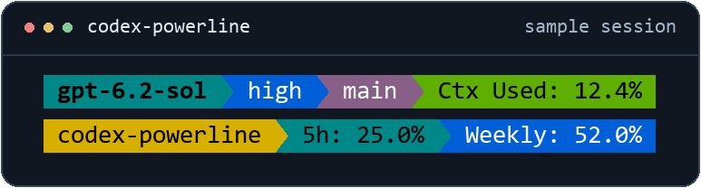

<div align="center">

# Codex Powerline

**A customizable Powerline status bar for the OpenAI Codex CLI.**

See your model, context, usage limits, and Git state in your terminal.

[](https://www.npmjs.com/package/codex-powerline)
[](LICENSE)
[](https://nodejs.org/)



</div>

## Contents

- [Install](#-install)
- [Quick Start](#quick-start)
- [Features](#features)
- [Usage](#usage)
- [Contributing](#-contributing)
- [Changelog](CHANGELOG.md)
- [Development](#development)
- [Author and Acknowledgments](#author-and-acknowledgments)
- [License](#license)

## 🚀 Install

Install [Codex CLI](https://developers.openai.com/codex/cli/) and Node.js 22.12
or newer. Then install Codex Powerline with npm.

### 📦 npm

```sh
npm install -g codex-powerline
```

After the install, use `codex-powerline configure` to edit settings and
`codex-powerline run` to start the multiline footer.

### 🪟 Windows

Run the npm command above in PowerShell. Then start the editor:

```powershell
codex-powerline configure
```

Use Windows Terminal and a Powerline-compatible or Nerd Font if arrow
separators appear as boxes. If the launcher cannot find Codex, set its full
path before you start it:

```powershell
$env:CODEX_POWERLINE_CODEX = 'C:\path\to\codex.exe'
codex-powerline run
```

### 🍎 macOS and 🐧 Linux

Run the npm command above in your terminal. Then start the editor:

```sh
codex-powerline configure
```

## Quick Start

Use **Edit Lines** to add and reorder widgets. Open **Powerline Setup** to
choose a theme and separators. The editor previews your changes as you make
them. Press **Ctrl+S** to save, or choose **Save & Exit**.

Start Codex with the Powerline layout:

```sh
codex-powerline run
```

## Features

- **Live preview:** Arrange widgets, set labels and colors, and preview each row
  before you save.
- **Powerline themes:** Use colored segments, custom separators, padding,
  alignment, and a choice of terminal color levels.
- **Codex metrics:** Display model, reasoning effort, context, tokens, cache,
  and 5-hour or weekly usage. A widget uses data from the active Codex session
  when that data is available.
- **Project and session information:** Show the ChatGPT workspace, working directory,
  Git or Jujutsu state, and Codex permissions. Add your own text, links, or command output.
- **Portable layouts:** Export a configuration as JSON. Import it later by
  merging it with your settings or replacing them.

## Usage

### Launch Codex with Powerline

```sh
codex-powerline run resume --last
codex-powerline --config ./configTemplates/powerline.json run
```

`run` shows all configured rows, including ANSI links. It forwards Codex
arguments and leaves your Codex config file unchanged. It needs a Codex release
that supports `--remote`, `--remote-auth-token-env`, and the
[Codex App Server](https://learn.chatgpt.com/docs/app-server). Set its refresh
interval in **Configure Status Line**. With `run --no-alt-screen`, use
**Shift+Page Up** and **Shift+Page Down** to browse the wrapper's scrollback.
The wrapper uses an alternate terminal screen, so its scrollback is not copied
to the shell on exit.

The **ChatGPT Workspace** widget shows the name of the workspace selected when
you sign in to Codex. The widget stays hidden if Codex does not report a name.
Use **Current Working Dir** for the local path.

### Save or import a layout

Settings live at `~/.config/codex-powerline/settings.json`, including on Windows.
Pass `--config PATH` before the command to use another file. Start with the
[Powerline preset](configTemplates/powerline.json) or the
[classic layout](configTemplates/classic.json). Use **Import Config** to
load a previous layout. The old `git-pr` widget ID migrates to `git-review`.
Unknown widgets stay in the file, but do not render. Only import custom command
widgets from configurations you trust.

### Render without Codex

```sh
codex-powerline --config ./configTemplates/powerline.json render < scripts/payload.example.json
```

```powershell
Get-Content -Raw scripts/payload.example.json | codex-powerline --config ./configTemplates/powerline.json render
```

Use `CODEX_POWERLINE_WIDTH` to set the render width.

## Development

```sh
bun install --frozen-lockfile
bun run start configure
bun test
bun run lint
bun run build
```

See [AGENTS.md](AGENTS.md) for the project map and reusable development workflows.

## 🤝 Contributing

Contributions are welcome. Open an issue to report a bug or discuss a larger
change. For a code change, fork the repository, create a focused branch, add
tests when they fit, and open a pull request.

Before you open a pull request, run:

```sh
bun test
bun run lint
bun run build
```

## Author and Acknowledgments

**Martin Hájek** is the author and maintainer of Codex Powerline.

Inspired by [ccstatusline](https://github.com/sirmalloc/ccstatusline), created
by Matthew Breedlove. The first version was based on that project. See
[NOTICE](NOTICE) for the upstream attribution and [CHANGELOG.md](CHANGELOG.md)
for release history.

## License

MIT. See [LICENSE](LICENSE) for the terms and copyright notices.
